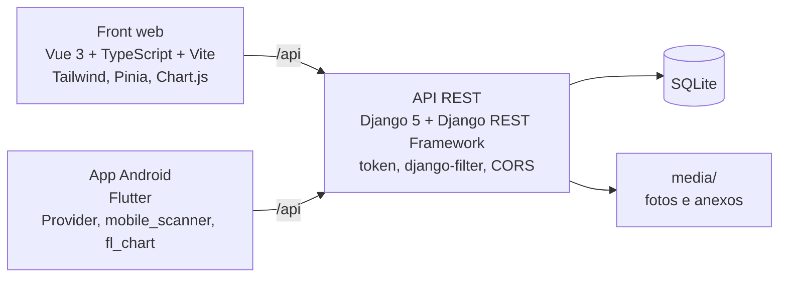

# MangeTech

Sistema de chamados de manutenção e gestão de ativos para o chão de fábrica: abre e acompanha chamados, cadastra equipamentos com QR code e mostra indicadores para a gestão. Tem API em Django, front web em Vue e app Android em Flutter.

Projeto Integrador do grupo MangeTech. Este repositório substituiu o `Integrador4_Final`, criado por causa de problemas de merge no repositório anterior; o fork antigo guarda os protótipos de tela, copiados em [`docs/prototipos`](docs/prototipos).

## Funcionalidades

O que existe de verdade no código (`chamados/models.py`, `chamados/views.py`, as views do Vue e as telas do Flutter):

- **Chamados** — abertura com título, descrição, ativo, ambiente, urgência (Crítico, Alta, Média, Baixa) e data sugerida. Status `ABERTO` → `AGUARDANDO RESP` → `EM ANDAMENTO` → `REALIZADO` → `CONCLUÍDO`, ou `CANCELADO`. Cada mudança de status pede uma descrição, aceita fotos e vira uma linha do histórico. Comentários com fotos, anexos de arquivo, filtros (status, urgência, ambiente, solicitante, responsável, período, "meus chamados", críticos em aberto, sem responsável, atrasados), busca, ordenação, exportação em CSV e exclusão em lote. Chamado em andamento não pode ser excluído.
- **Ativos** — cadastro de equipamentos (código/tag, nome, modelo, fabricante, número de série, fornecedor, ambiente, status Ativo/Inativo/Manutenção), QR code gerado pela API em PNG (com etiqueta de código e nome), leitura do QR pelo app para abrir o ativo, lista de chamados do ativo e histórico de movimentações.
- **Usuários e papéis** — cadastro e login por e-mail com token (`TokenAuthentication` do DRF). Usuário comum só vê os chamados em que é solicitante ou responsável; usuário *staff* vê todos, acessa o dashboard, gerencia usuários e altera permissões. Perfil com edição de dados, troca de senha e estatísticas pessoais.
- **Recuperação de senha** — código numérico de 6 dígitos enviado por e-mail, válido por 15 minutos e com limite de 5 tentativas. Verificação de e-mail antes do uso (sintaxe e registro MX do domínio).
- **Dashboard gerencial** — totais por status e por urgência, chamados críticos em aberto e volume nos últimos 7, 30 e 90 dias; gráficos com Chart.js na web e fl_chart no app. Os indicadores de tempo médio e de faixa de resolução ainda são valores ilustrativos fixos no código.
- **Admin do Django** para todos os modelos.

## Arquitetura



A API é a única fonte de dados; web e app só falam com ela. O endereço da API é configurável nos dois clientes (ver "Como rodar").

## Estrutura de pastas

```
MANGETECH/
  Back/                 API Django (projeto Back, app chamados)
    Back/               settings, urls, wsgi
    chamados/           models, serializers, views, filters, urls, admin,
                        qr_generator, email_service,
                        management/commands/seed_demo.py
    .env.example        variáveis de ambiente da API
    requirements.txt
  front-end/            front web Vue 3 + TypeScript (Vite, Tailwind, Pinia)
    src/api/            cliente axios e chamadas à API
    src/views/          telas   src/stores/ estado   src/components/ layout e modais
    .env.example        VITE_API_URL
    vercel.json         rewrite de SPA para o Vercel
  app_integrador/       app Flutter
    lib/data/           api_service e providers
    lib/ui/             telas (screens), widgets e tema
docs/prototipos/        telas do Figma da primeira versão (HTML)
render.yaml             publicação da API no Render
LICENSE                 MIT
```

## Como rodar

### API (Django)

```bash
cd MANGETECH/Back
python -m venv .venv
.venv\Scripts\activate          # Linux/macOS: source .venv/bin/activate
pip install -r requirements.txt
copy .env.example .env          # Linux/macOS: cp .env.example .env
python manage.py migrate
python manage.py seed_demo      # dados de demonstração (opcional)
python manage.py runserver
```

A API responde em `http://localhost:8000/api/` e o admin em `http://localhost:8000/admin/`.

Variáveis de ambiente (lidas do `.env` ao lado do `manage.py` ou do ambiente):

| Variável | Padrão | Para que serve |
|---|---|---|
| `SECRET_KEY` | chave aleatória a cada início | Em produção precisa ser fixa. |
| `DEBUG` | `False` | `True` só em desenvolvimento. |
| `ALLOWED_HOSTS` | `localhost,127.0.0.1` | Hosts aceitos, separados por vírgula. |
| `CORS_ALLOWED_ORIGINS` | portas locais do Vite e do Flutter web | Origens do front. Com `DEBUG=True`, qualquer origem é aceita. |
| `CSRF_TRUSTED_ORIGINS` | as mesmas do CORS | Precisa do esquema (`https://...`). |
| `EMAIL_HOST_USER`, `EMAIL_HOST_PASSWORD` | vazios | Com os dois, a recuperação de senha envia por SMTP; sem eles, o e-mail sai no console. |
| `FRONTEND_URL` | `http://localhost:5173` | Link do front nos e-mails. |

### Front web (Vue)

```bash
cd MANGETECH/front-end
npm install
copy .env.example .env          # VITE_API_URL=http://localhost:8000/api
npm run dev
```

Abre em `http://localhost:5173`. `npm run build` gera a pasta `dist/`; no Vercel, o `vercel.json` já redireciona todas as rotas para o `index.html`. Sem `VITE_API_URL`, o front usa a API publicada no Render (`https://mangetech-api.onrender.com/api`).

### App (Flutter)

```bash
cd MANGETECH/app_integrador
flutter pub get
flutter run --dart-define=API_URL=http://10.0.2.2:8000/api
```

`10.0.2.2` é o endereço da máquina visto de dentro do emulador Android. Em aparelho físico, use o IP da máquina na rede (`http://192.168.x.x:8000/api`) e inclua esse IP em `ALLOWED_HOSTS` da API. Sem `--dart-define`, o padrão é o do emulador.

### Usuário de demonstração

`python manage.py seed_demo` cria dois usuários, quatro ativos e seis chamados. O login é pelo e-mail:

| E-mail | Senha | Papel |
|---|---|---|
| `demo@mangetech.local` | `demo1234` | staff (vê tudo, dashboard, usuários) |
| `tecnico@mangetech.local` | `demo1234` | usuário comum (responsável por chamados) |

As senhas são públicas de propósito. O comando pode rodar mais de uma vez: não duplica nada.

## Demonstração

- Front web: <https://integrador4-final.vercel.app>
- API: `https://mangetech-api.onrender.com/api` (Render, plano gratuito: dorme sem uso e leva uns 30 s para acordar no primeiro acesso; o banco é reposto pelo `seed_demo` a cada deploy). A API original do curso, no Azure, saiu do ar; o [`render.yaml`](render.yaml) é o que publica esta.

<!-- prints: adicionar -->

## Equipe

- Diogo Vieira de Lima — [@DiogusVincere](https://github.com/DiogusVincere)
- Gustavo Mendes — [@Guga-Sistemas](https://github.com/Guga-Sistemas)
- Gabriel Lopes — [@gabriel-adssenai](https://github.com/gabriel-adssenai)
- Guilherme Rosa — [@guilhermebombado](https://github.com/guilhermebombado)

## Licença

[MIT](LICENSE) — Copyright (c) 2025 Diogo Vieira de Lima e equipe MangeTech.
